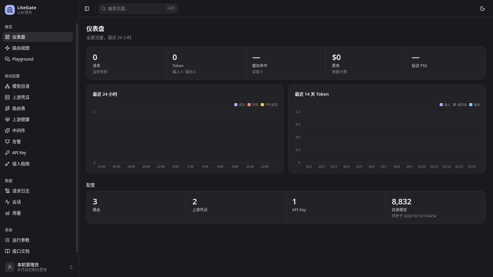
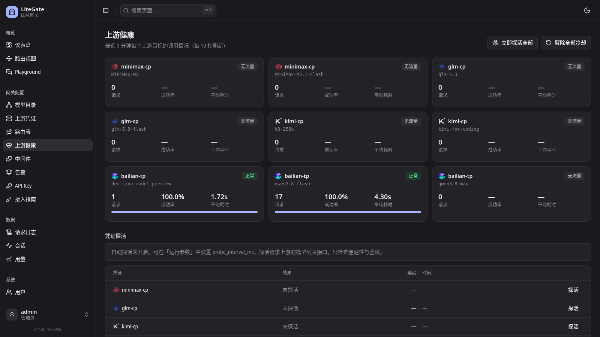
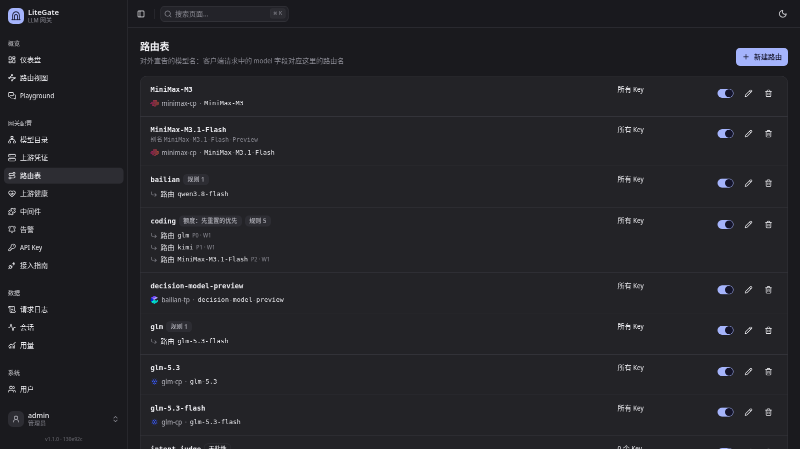
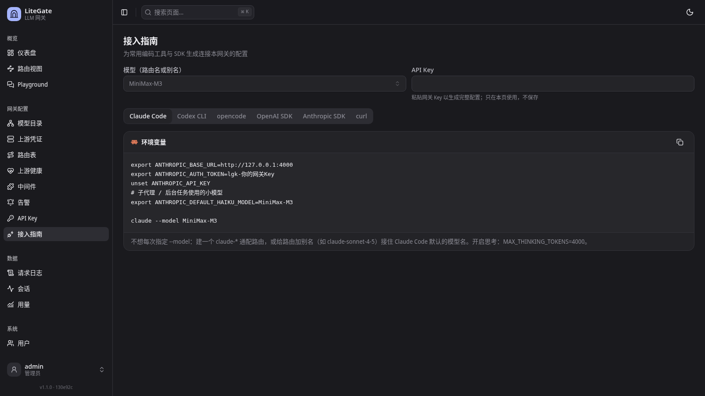

# LiteGate

English | [简体中文](README.md)

LiteGate is a unified LLM API gateway built on Erlang/OTP, compatible with both the OpenAI and Anthropic API formats.
It provides multi-credential routing, failover, quota control, rule-based routing, session stickiness, usage billing and an admin console.

**Dashboard**: request and token trends, upstream quotas and budgets, 429 throttling status



**Upstream health**: credential cooldowns, throttling and outbound rate (RPM)



**Routes**: target priorities, fallback chains and rule counts



**Integrations**: client configuration for Claude Code, Codex and opencode



## Documentation

| Document | Contents |
|---|---|
| [Architecture](docs/en/architecture.md) | Components, request flow, data model and console |
| [Configuration](docs/en/configuration.md) | Configuration layers, core parameters, security and backups |
| [Routing](docs/en/routing.md) | Route matching, fallback, strategies, rules and cooldowns |
| [Integrations](docs/en/integrations.md) | OpenAI, Anthropic, Claude Code, Codex, opencode and SDK tests |
| [Observability](docs/en/observability.md) | Logs, usage, metrics, tracing, alerts and health |
| [Deployment](docs/en/deploy.md) | systemd build, installation, operations, backups and upgrades |
| [Development](docs/en/development.md) | Local build, tests, checks and project layout |
| [Changelog](CHANGELOG.en.md) | Version changes and breaking changes |

## Requirements

- Erlang/OTP 27 or later, rebar3
- CMake, a C++23 compiler, `libicu-dev`
- Node.js

## Quick start

```sh
rebar3 compile
cd web
npm install
npm run build
cd ..
rebar3 shell
```

Open `http://localhost:4000/console` and follow the setup guide:

1. Sync the model catalog
2. Add upstream credentials
3. Create a route
4. Create an API key

The console is available in Chinese and English; switch with the language button in the top bar (it defaults to the browser language).

Send an OpenAI-format request:

```sh
curl http://localhost:4000/v1/chat/completions \
  -H "Authorization: Bearer lgk-..." \
  -H "Content-Type: application/json" \
  -d '{"model": "<route-name>", "messages": [{"role": "user", "content": "hi"}]}'
```

For Anthropic clients, point the base URL at `http://localhost:4000` and pass the same gateway key in `x-api-key`.

## Docker

The image is built in three stages (console frontend → Erlang release → slim runtime). State lives in `/data` inside the container,
and runtime parameters are passed as `LITEGATE_*` environment variables.

```sh
docker build -t litegate .
docker run -d --name litegate -p 4000:4000 -v litegate-data:/data litegate
```

Deploying with compose (recommended; configuration is read from `deploy/litegate.env`, see `deploy/litegate.env.example` for a template):

```sh
docker compose build --build-arg GIT_SHA=$(git rev-parse --short HEAD)
docker compose up -d
docker compose logs -f
```

Inside the container the gateway listens on `0.0.0.0`, so console login must be enabled: `LITEGATE_CONSOLE_AUTH=true`,
with `LITEGATE_ADMIN_PASSWORD` creating the admin account on first start. With a non-loopback bind and login disabled the gateway refuses to start,
unless you explicitly accept the risk with `LITEGATE_ALLOW_INSECURE_BIND=true` (trusted, isolated networks only).
