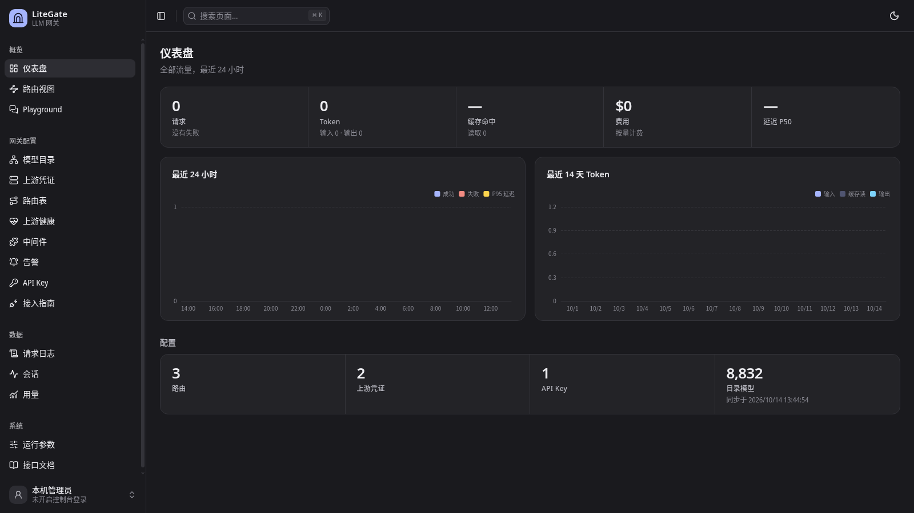
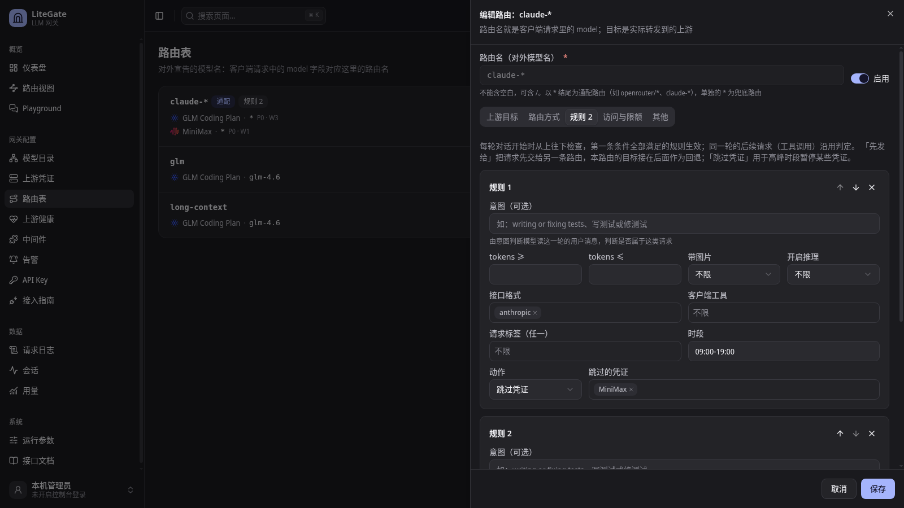
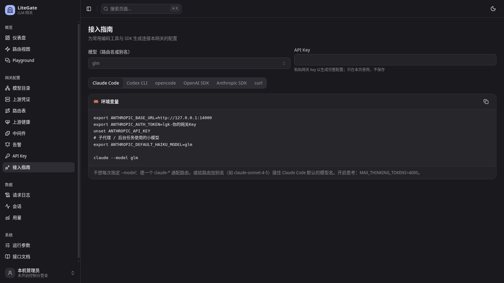

# LiteGate

LiteGate 是基于 Erlang/OTP 的 LLM API 统一网关，兼容 OpenAI 与 Anthropic 接口格式。
它提供多凭证路由、失败回退、额度控制、规则路由、会话粘性、用量计费和管理控制台。







## 文档

| 文档 | 内容 |
|---|---|
| [架构](docs/architecture.md) | 组件划分、请求链路、数据模型和控制台 |
| [配置](docs/configuration.md) | 配置分层、核心参数、安全和备份 |
| [路由](docs/routing.md) | 路由匹配、回退、策略、规则和冷却 |
| [接入](docs/integrations.md) | OpenAI、Anthropic、Claude Code、Codex、opencode 和 SDK 测试 |
| [可观测性](docs/observability.md) | 日志、用量、指标、链路、告警和健康 |
| [部署](docs/deploy.md) | systemd 构建、安装、运维、备份和升级 |
| [开发](docs/development.md) | 本地构建、测试、检查和项目结构 |

## 依赖

- Erlang/OTP 27 或更新版本、rebar3
- CMake、支持 C++23 的编译器、`libicu-dev`
- Node.js

## 快速开始

```sh
rebar3 compile
cd web
npm install
npm run build
cd ..
rebar3 shell
```

打开 `http://localhost:4000/console`，按引导完成初始化：

1. 同步模型目录
2. 添加上游凭证
3. 创建路由
4. 创建 API Key

发送 OpenAI 格式请求：

```sh
curl http://localhost:4000/v1/chat/completions \
  -H "Authorization: Bearer lgk-..." \
  -H "Content-Type: application/json" \
  -d '{"model": "<路由名>", "messages": [{"role": "user", "content": "hi"}]}'
```

Anthropic 客户端把基础地址指向 `http://localhost:4000`，并用 `x-api-key` 传入同一个网关 Key。

## Docker

```sh
docker build -t litegate .
docker run -d --name litegate -p 4000:4000 -v litegate-data:/data litegate
```

容器状态保存在 `/data`。运行参数使用 `LITEGATE_*` 环境变量传入。把端口暴露到非本机环境前，
应先创建管理员并开启控制台登录。
